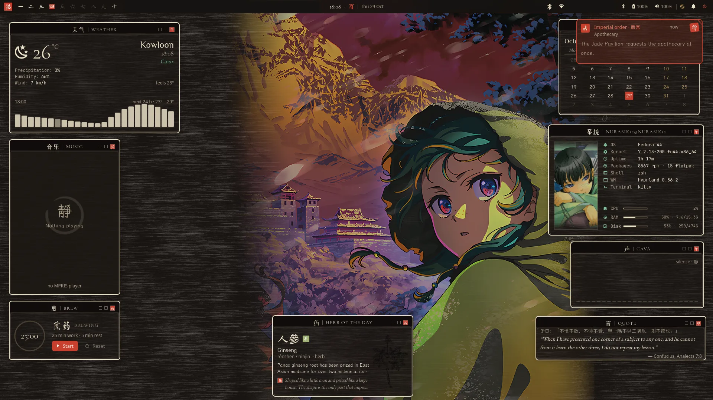
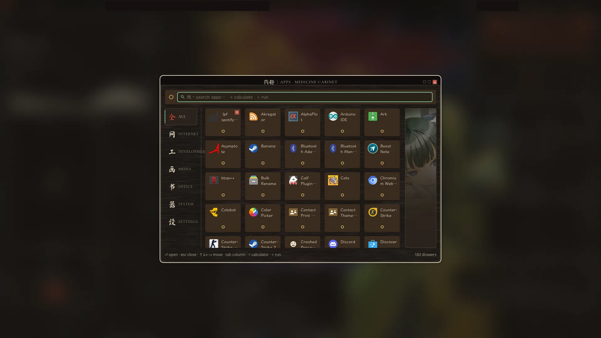
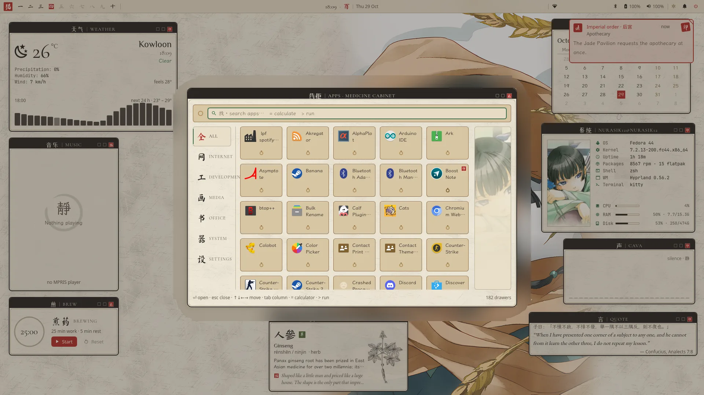
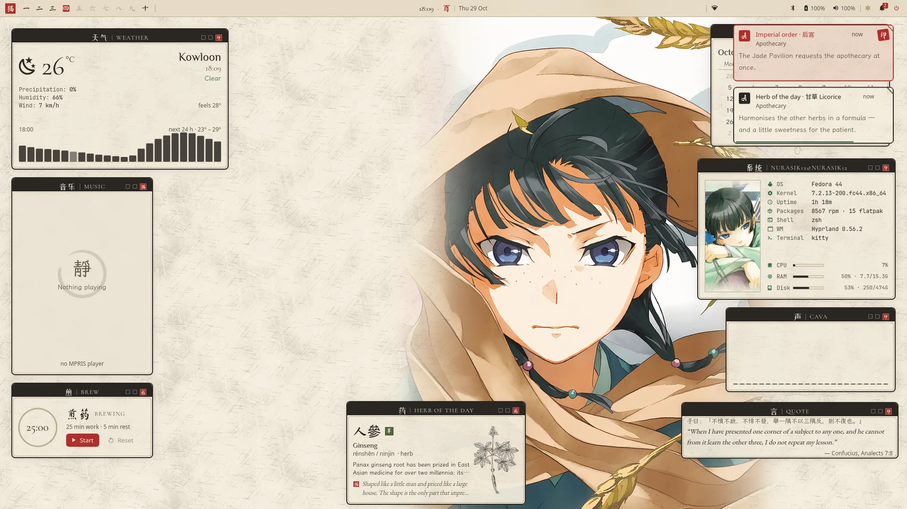
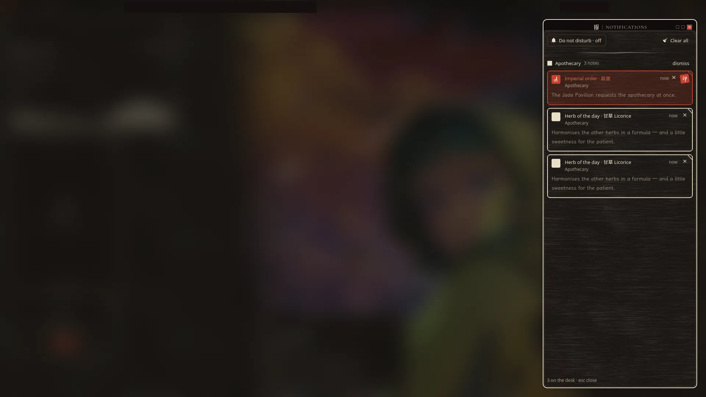
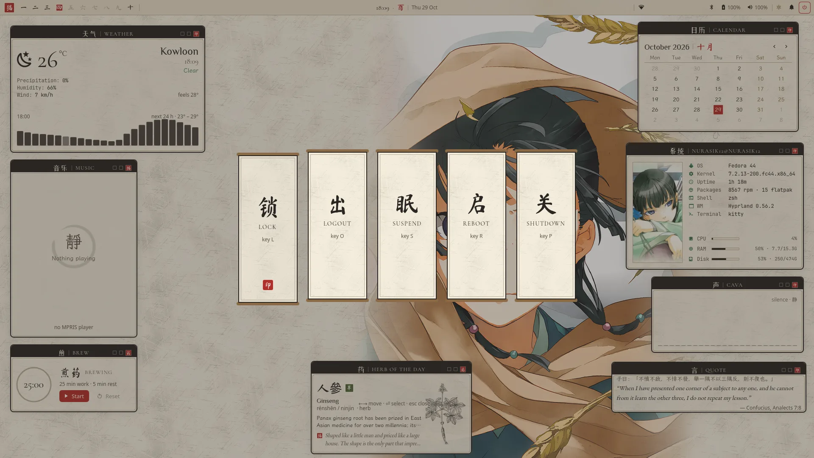
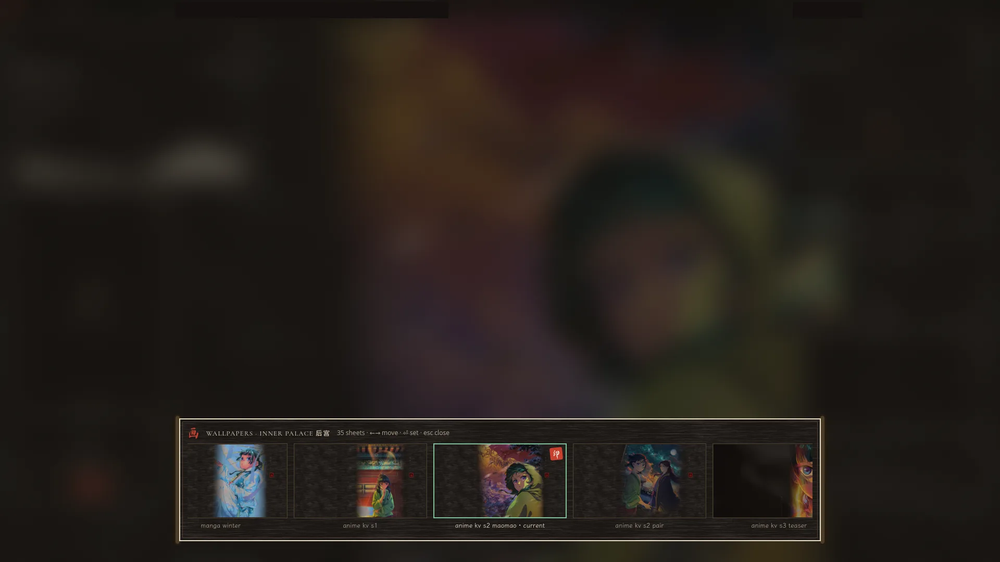
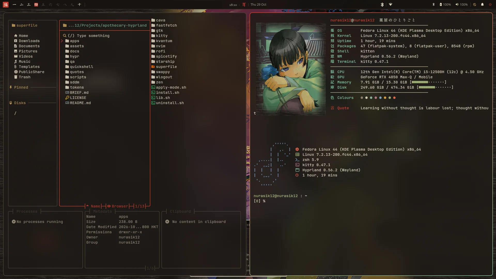
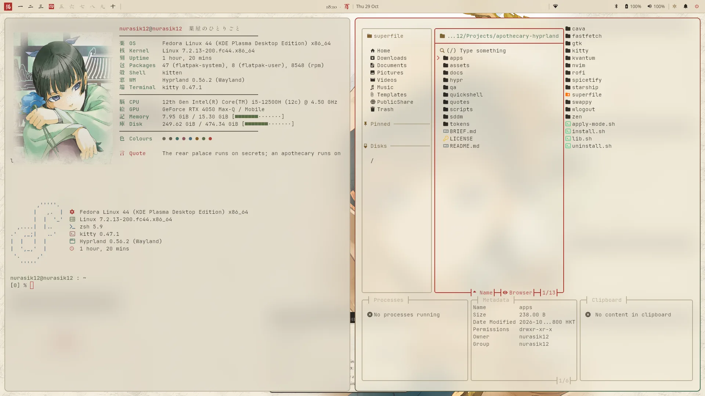

# Apothecary Hyprland — 薬屋のひとりごと

A Hyprland desktop theme built around **Maomao** from *The Apothecary Diaries* (薬屋のひとりごと):
the desktop is her workbench in the Rear Palace — rice paper, sumi ink, lacquer, herbs and the red seal
of the inner court. Two moods, switchable live:

| mode | | feel |
|---|---|---|
| `light` | Apothecary 薬屋 | rice-paper cream, sumi ink, celadon green, a touch of vermilion and gold |
| `dark` | Inner Palace 后宫 | night lacquer, vermilion, antique gold, jade, paper-cream text |

## A theme system you can switch on and off

Apothecary Hyprland is a **theme system**, not a replacement set of dotfiles. It sits as a layer on top of
[JaKooLit's Fedora-Hyprland dotfiles](https://github.com/JaKooLit/Fedora-Hyprland): nothing of the base config is
edited in place, and one command switches the whole theme on or off in the running session, without logging out.

```sh
apothecary on       # theme on: Hyprland layer, Quickshell shell, hyprlock/hypridle, app themes, wallpaper
apothecary off      # theme off: the stock JaKooLit desktop comes back (~5 s)
apothecary status   # which state you are in
```

How the switch works:

- `scripts/install.sh` adds a single line to `~/.config/hypr/hyprland.conf` that sources `hypr/apothecary.conf`.
  That file sources `~/.config/apothecary/active.conf`, a symlink the CLI points at `hypr/on.conf` (the theme) or
  `hypr/off.conf` (empty) and then runs `hyprctl reload`.
- **On** also stops waybar and the notification daemon, starts the Quickshell shell (`qs -c apothecary`), swaps in
  the theme's hyprlock and hypridle configs, sets the mode's wallpaper and applies the matching app themes.
- **Off** reverses every one of those steps: waybar, swaync/mako, the stock hypridle, your original
  `hyprlock.conf`, GTK settings, kitty colours and your previous wallpaper all come back.
- The choice survives logout and reboot (`~/.config/apothecary/enabled` marks it on; with the marker gone the
  login hook does nothing).
- Light/dark (`SUPER+T`) is a separate switch *inside* the theme. Use it while the theme is on; run while it is off,
  it still changes the wallpaper and app colours.
- Off is not uninstall: `scripts/uninstall.sh` removes the hook, links and app files completely. The SDDM login
  theme is installed separately with sudo and is not affected by on/off (see
  [docs/SUDO-STEPS.md](docs/SUDO-STEPS.md)).

## Screenshots

**Inner Palace 后宫 (dark)** — the desktop as Maomao's workbench: framed cards with lacquer title bars and red seals.



**Apothecary 薬屋 (light)** — rice paper and sumi ink; `SUPER+T` cross-fades between the two.


| | |
|---|---|
|  |  |
| **Launcher** — a medicine cabinet of labelled drawers (`SUPER+Space`) | same cabinet by daylight |
|  |  |
| **Notifications** — paper notes; critical ones are red-sealed *imperial orders* | **Notification centre** with do-not-disturb (`SUPER+I`) |
|  |  |
| **Power menu** — five hanging scrolls (`SUPER+Escape`) | **Wallpaper picker** — a hand-scroll of the mode's set (`SUPER+W`) |
|  |  |
| **kitty + superfile + fastfetch** in lacquer | …and on paper |

<sub>The screenshots show official light-novel / anime art used as wallpaper; the art files themselves are not distributed here — see *Art and credits*. Screenshots taken on the real machine (1920×1080), Wi-Fi name and window titles blanked.</sub>

## What you get

- **Quickshell shell** (replaces waybar + the notification daemon while on): top bar with 一 二 三 … workspaces and a
  red-seal active marker, a 時辰 clock (`17:42 · 酉`), tray, Wi-Fi / BT / battery / volume chips.
- **Medicine-cabinet launcher** (fuzzy search, categories as cabinet columns, `=1+1` calculator, `>cmd` run).
- **Paper-note notifications** — critical ones arrive as a red-sealed *imperial order*; notification centre with DND.
- **Network panel** (nmcli: scan, connect with password, VPNs, inline errors), **power menu** of hanging scrolls,
  **wallpaper picker** (hand-scroll of thumbnails, per mode), ink-bar **OSD**.
- **Desktop widgets** as framed cards with lacquer title bars: weather (Open-Meteo), music (MPRIS + album art),
  calendar, system info, cava, quote of the day, herb/poison of the day, a *brewing medicine* focus timer.
  Drag a card by its title bar to move it.
- Slow, soft **ink** animations (no bounce), translucent paper windows, hyprlock + hypridle, an SDDM theme,
  synthesized wood-block / guqin sound cues.
- Matching themes for kitty, rofi, GTK 3/4, Qt (Kvantum + qt6ct), superfile, btop, cava, fastfetch (with Maomao),
  starship, spicetify, Zen browser, neovim, wlogout, swappy.

## Install

Requirements: Hyprland ≥ 0.56, Quickshell (`qs`) 0.3, awww (swww fork), kitty, ImageMagick 7, python3 + numpy,
jq, pw-play, nmcli, playerctl. Fonts: Ma Shan Zheng, ZCOOL XiaoWei, LXGW WenKai, Shippori Mincho B1, Yuji Syuku,
Cormorant Garamond, EB Garamond, JetBrainsMono Nerd Font, Noto Sans/Serif CJK.

```sh
git clone <this repo> ~/Projects/apothecary-hyprland && cd ~/Projects/apothecary-hyprland
assets/fetch-art.sh            # downloads the character art (not redistributed here, see below)
scripts/make-wallpapers.sh     # builds the light/dark wallpaper sets from it
python3 tokens/build.py        # generates every per-app colour file from tokens/tokens.json
scripts/install.sh             # links the layer into ~/.config (idempotent; scripts/uninstall.sh reverses it)
apothecary on                  # turn it on; `apothecary off` to go back
```

Details: [docs/INSTALL.md](docs/INSTALL.md) · keybinds: [docs/KEYBINDS.md](docs/KEYBINDS.md) ·
a tour of Hyprland on this setup: [docs/HYPRLAND-GUIDE.md](docs/HYPRLAND-GUIDE.md) ·
design system: [docs/DESIGN.md](docs/DESIGN.md) · shell: [docs/QUICKSHELL.md](docs/QUICKSHELL.md) ·
widgets: [docs/WIDGETS.md](docs/WIDGETS.md) · apps: [docs/APPS.md](docs/APPS.md) ·
steps that need root (SDDM, brightness kernel parameter): [docs/SUDO-STEPS.md](docs/SUDO-STEPS.md).

## Daily use

```
SUPER+Space launcher      SUPER+T light/dark       SUPER+W wallpapers     SUPER+G widgets on/off
SUPER+N network           SUPER+I notifications    SUPER+Esc power        SUPER+B brew timer
SUPER+E superfile         SUPER+SHIFT+G game mode  SUPER+ALT+R repair     SUPER+SHIFT+Space float window
apothecary on|off|status|light|dark|toggle|wallpaper next|prev|random|pick|reload|gamemode|repair
```

## Art and credits

Character art from the light novels (Touko Shino), manga (Nekokurage) and anime (TOHO animation / OLM) is
**not** included in this repository; `assets/fetch-art.sh` downloads it for personal use and
`scripts/make-wallpapers.sh` composes the wallpapers locally. Public-domain herb plates (植物名實圖考), generated
textures, synthesized sounds and the quote sources are listed in [assets/CREDITS.md](assets/CREDITS.md).
Layout inspiration: qxb3's "ink" rice and end-4's dots-hyprland (no files copied).

The process notes in `docs/agent-prompts/`, `docs/STATUS.md` and `qa/` are the build log: the theme was designed and
implemented by a team of AI agents (Hermes + Claude) under the owner's direction, then QA-tested on real hardware.

## License

Code and configuration: MIT (see [LICENSE](LICENSE)). Third-party art keeps its owners' rights.
